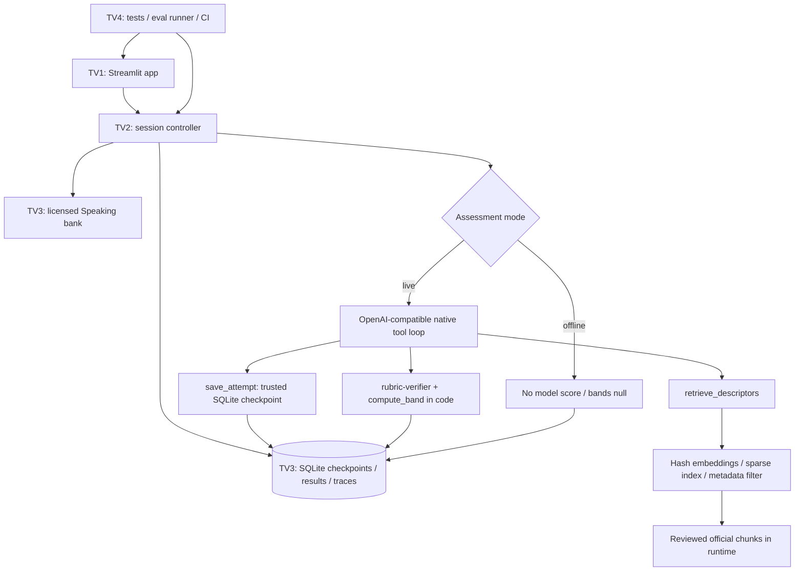

# Kiến trúc tham khảo

Điều phối câu hỏi/phần/thời gian bằng code để model không tự nhảy part.
Model chịu trách nhiệm bản chấm live có tool calling; follow-up hiện dùng template
tham chiếu quote có thật. Hai skill là speaking-examiner và rubric-verifier,
không có multi-agent/MCP trong UC-03 này. Các UC K6 thuộc backlog toàn đồ án.
